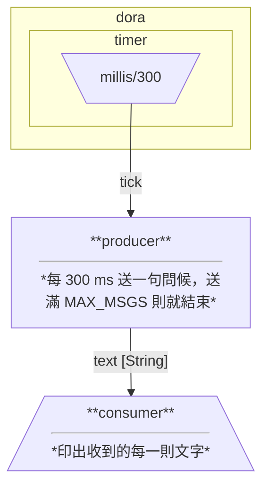

# dora-rs 教學 第 3 篇：逐行讀懂 dataflow.yml

> 版本：dora v1.1.0（CLI 與 `dora-node-api` 同版）　驗證日期：2026-11-03（台北時間），x86_64 Linux 上實際 `dora validate` / `dora build` / `dora run` 成功（結束碼 0）。


- [返回教材總覽](../../README.md)
- 上一課：[第 2 篇](lesson-02.md)
- 下一課：[第 4 篇 →](lesson-04.md)
- 本課範例：[examples/lesson-03/](../../examples/lesson-03/)

**導覽**

- [返回教材總覽](../../README.md)
- 上一課：[第 2 篇](lesson-02.md)
- 下一課：[第 4 篇 →](lesson-04.md)
- 本課範例：[examples/lesson-03/](../../examples/lesson-03/)

## 目錄

- [重點說明](#重點說明)
- [完整可執行範例](#完整可執行範例)
- [小練習](#小練習)
## 重點說明

`dataflow.yml` 是整個資料流的「接線圖」：有哪些節點、每個節點執行哪個程式、吃誰的輸出、又產生什麼輸出。dora 讀完這個檔，就知道要起哪些行程、怎麼把資料送過去。

### 1. 最外層（整個資料流）

- **`nodes:`** — 節點清單（必填）
- **`env:`** — 全資料流共用的環境變數，每個節點都會拿到
- **`strict_types: true`** — 型別宣告不符就當作錯誤（見第 5 節）
- **`health_check_interval` / `exit_when_nodes_finish` / `type_rules`** — 進階選項，之後的篇章再碰

### 2. 每個節點最常用的欄位

- **`id`** — 節點名稱，**不能含 `/`**（因為 `節點/輸出` 用 `/` 分隔）
- **`description`** — 給人看的說明，`dora graph` 會畫出來
- **`build`** — `dora build` 時執行的指令，**每一行是獨立的一個指令**，以空白分隔參數
- **`path`** — 要執行的程式；相對路徑是相對於 **YAML 檔所在目錄**
- **`args`** — 傳給程式的命令列參數，以空白分隔，引號可用（實測 `--prefix "[A] "` 會被正確當成一個參數）
- **`env`** — 這個節點的環境變數，**`build` 與執行時都會套用**；值可以是字串、數字、布林
- **`inputs`** — 輸入：`本地名稱: 來源`
- **`outputs`** — 這個節點會送出的輸出名稱清單
- **`input_types` / `output_types`** — 選填的型別宣告（只做檢查，不影響執行）

另外還有一批「讓節點更穩」的欄位，會在後面的篇章用到：`restart_policy`（`never` / `on-failure` / `always`）搭配 `max_restarts`、`restart_delay`（第 9 篇）、`queue_size` / `queue_policy`（第 8 篇）、`health_check_timeout`、`cpu_affinity`、`send_stdout_as`、`git` / `branch` / `tag` / `rev`（從 git 抓節點原始碼，第 14 篇分散式會用到）。

### 3. 輸入的兩種寫法

**短寫法**：`本地名稱: 來源節點/輸出名稱`

```yaml
inputs:
  text: producer/text
```

**長寫法**：要加選項（例如佇列長度）時改用 `source:`

```yaml
inputs:
  text:
    source: producer/text
    queue_size: 10        # 這個輸入最多排 10 則；預設政策 drop_oldest，滿了丟最舊的
```

`queue_policy` 可以是 `drop_oldest`（預設）或 `backpressure`（最多緩衝 `queue_size` 的 10 倍，不先丟；到上限才丟並記 ERROR）。這些在第 8 篇會實測。

**內建計時器**：來源寫成 `dora/timer/{單位}/{數值}`，例如 `dora/timer/millis/300`（每 300 毫秒一次）。節點收到的是一個空陣列的 `Input` 事件（第 2 篇看過 `NullArray(0)`），意思只是「時間到了」。

### 4. `path` 與工作目錄的小陷阱

- `path: target/debug/producer` 是相對 YAML 所在目錄，所以 `Cargo.toml` 和 `dataflow.yml` 放同一層最單純。
- `build` 與執行的工作目錄也是 YAML 所在目錄（log 裡可以看到 `running build command: ... in /…/lesson-03`）。
- 如果用 `git:` 抓節點，工作目錄則是 clone 下來的目錄。

### 5. 型別宣告與 `dora validate`

`output_types` / `input_types` 用 `std/core/v1/String` 這種 URN 標註資料型別。**它們只在 `dora validate` 和 `dora build` 時檢查，執行時沒有額外負擔。**

```bash
dora validate dataflow.yml                 # 檢查接線、設定、型別
dora validate --strict-types dataflow.yml  # 型別警告也算失敗（適合 CI）
```

實測三種情況：

```text
# (a) 正常
Input/output wiring OK.
Descriptor config OK.
All type annotations OK.                      → 結束碼 0

# (b) 輸出名稱打錯（producer/txet）
[ERROR] wiring check failed
    output `producer/txet` mapped to input `consumer/text` does not exist   → 結束碼 1

# (c) 上游宣告 String、下游宣告 UInt64
Type warnings:
  - node "consumer": type mismatch on input "text": upstream producer/text declares "std/core/v1/String", but expected "std/core/v1/UInt64"
                                              → 一般模式結束碼 0（只警告）；加 --strict-types 結束碼 1
```

重點：**接線錯誤一定擋下，型別不符預設只是警告**。想讓型別不符也擋下，就加 `--strict-types`，或在 YAML 最上面寫 `strict_types: true`。

### 6. 畫出資料流：`dora graph`

```bash
dora graph --mermaid dataflow.yml
```

實測輸出（可貼到 mermaid.live 或任何支援 Mermaid 的 Markdown）：



不加 `--mermaid` 會產生 HTML 檔；有型別宣告的連線，線上會顯示 `[String]`。

## 完整可執行範例

專案結構（與第 1 篇一樣，一個 package 兩個執行檔）：

```
examples/lesson-03/
├── Cargo.toml
├── dataflow.yml
└── src/bin/
    ├── producer.rs
    └── consumer.rs
```

`Cargo.toml`：

```toml
[package]
name = "lesson-03"
version = "0.1.0"
edition = "2024"

[dependencies]
dora-node-api = "1.1.0"
eyre = "0.6"
```

`dataflow.yml`（把本篇講的欄位都用上）：

```yaml
# 全資料流共用的環境變數（每個節點都會拿到）
env:
  RUST_LOG: info

nodes:
  - id: producer
    description: 每 300 ms 送一句問候，送滿 MAX_MSGS 則就結束
    build: cargo build --bin producer
    path: target/debug/producer
    args: --prefix "[A] "
    env:
      GREETING: "哈囉"
      MAX_MSGS: 4          # 數字也可以，dora 會轉成字串
    inputs:
      tick: dora/timer/millis/300
    outputs:
      - text
    output_types:
      text: std/core/v1/String

  - id: consumer
    description: 印出收到的每一則文字
    build: cargo build --bin consumer
    path: target/debug/consumer
    inputs:
      text:                       # 長寫法：可以加每個輸入的選項
        source: producer/text
        queue_size: 10            # 這個輸入最多排 10 則，超過丟最舊的
    input_types:
      text: std/core/v1/String
```

`src/bin/producer.rs`：

```rust
use dora_node_api::{DoraNode, Event, IntoArrow, dora_core::config::DataId};
use std::env;

fn main() -> eyre::Result<()> {
    // 1) env：YAML 的 env 會變成這個行程的環境變數
    let greeting = env::var("GREETING").unwrap_or_else(|_| "（沒設 GREETING）".into());
    let max: u32 = env::var("MAX_MSGS").ok().and_then(|v| v.parse().ok()).unwrap_or(3);
    // 2) args：YAML 的 args 會變成命令列參數（以空白分隔）
    let prefix = env::args().skip_while(|a| a != "--prefix").nth(1).unwrap_or_default();
    println!("producer 啟動：greeting={greeting:?} max={max} prefix={prefix:?}");

    let (mut node, mut events) = DoraNode::init_from_env()?;
    let out = DataId::from("text".to_owned());
    let mut n = 0u32;
    while let Some(event) = events.recv() {
        match event {
            Event::Input { id, metadata, .. } if id.as_str() == "tick" => {
                n += 1;
                let msg = format!("{prefix}{greeting} #{n}");
                node.send_output(out.clone(), metadata.parameters, msg.as_str().into_arrow())?;
                if n >= max {
                    break;
                }
            }
            Event::Stop(_) => break,
            _ => {}
        }
    }
    Ok(())
}
```

`src/bin/consumer.rs`：

```rust
use dora_node_api::{DoraNode, Event};

fn main() -> eyre::Result<()> {
    let (_node, mut events) = DoraNode::init_from_env()?;
    let mut got = 0u32;
    while let Some(event) = events.recv() {
        match event {
            Event::Input { id, data, .. } => {
                let text: &str = TryFrom::try_from(&data)?;
                got += 1;
                println!("consumer 收到 [{id}]：{text}");
            }
            Event::InputClosed { id } => println!("輸入 {id} 已關閉（共收到 {got} 則）"),
            Event::Stop(_) => println!("收到停止訊號"),
            _ => {}
        }
    }
    Ok(())
}
```

執行：

```bash
export PATH=$HOME/dora/bin:$PATH
cd examples/lesson-03              # 在 clone 本 repo 後，於 repo 根目錄執行
dora validate dataflow.yml
dora build dataflow.yml
dora run dataflow.yml
```

**實測輸出（2026-11-03 08:10 台北時間，`dora run` 結束碼 0）**：

```text
08:10:40 stdout producer: producer 啟動：greeting="哈囉" max=4 prefix="[A] "
08:10:41 INFO   [dora]: daemon all nodes are ready, starting dataflow
08:10:41 stdout consumer: consumer 收到 [text]：[A] 哈囉 #1
08:10:41 stdout consumer: consumer 收到 [text]：[A] 哈囉 #2
08:10:41 stdout consumer: consumer 收到 [text]：[A] 哈囉 #3
08:10:42 stdout consumer: consumer 收到 [text]：[A] 哈囉 #4
08:10:42 stdout consumer: 輸入 text 已關閉（共收到 4 則）
08:10:42 stdout consumer: 收到停止訊號
08:10:42 INFO   producer: daemon producer finished successfully
08:10:42 INFO   consumer: daemon consumer finished successfully
08:10:42 INFO   [dora]: daemon dataflow finished on machine `01a19ebe-...`
```

可以對照看到：`env` 的 `GREETING`、`MAX_MSGS` 與 `args` 的 `--prefix` 都確實傳進了節點；送滿 4 則後 producer 結束，consumer 收到 `InputClosed`，整個資料流自然收尾。

> 編譯備註：第一次 `dora build` 要抓並編譯 zenoh 等相依套件，8 核約 2 分 37 秒；debug 產物約 3.6 GB，實驗完我已清掉 `target/`。你在自己的機器上練習完也建議 `cargo clean`。

## 小練習

1. 把 `producer` 的 `MAX_MSGS` 改成 `6`，`tick` 改成 `dora/timer/millis/100`，重跑。不改 Rust 程式，輸出會怎麼變？
2. 在 YAML 最上面加一行 `strict_types: true`，再把 consumer 的 `input_types` 故意改成別的型別，執行 `dora validate`，看結束碼是否變成 1。
3. 進階：新增第三個節點 `consumer2`（`path` 指向同一個 consumer 執行檔），也訂閱 `producer/text`，再用 `dora graph --mermaid` 畫出來。確認兩個 consumer 都收到 4 則。

下一篇：[第 4 篇：第一個像樣的 Rust 節點——`DoraNode` 與事件迴圈](lesson-04.md)。

---

**導覽**

- [返回教材總覽](../../README.md)
- 上一課：[第 2 篇](lesson-02.md)
- 下一課：[第 4 篇 →](lesson-04.md)
- 本課範例：[examples/lesson-03/](../../examples/lesson-03/)
